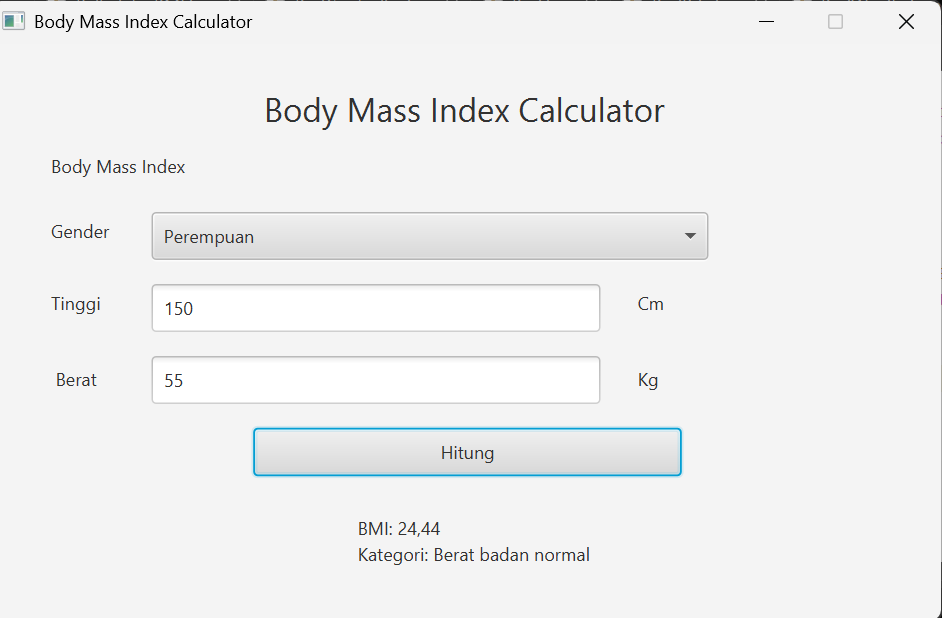

# 🧮 Kalkulator BMI

## Deskripsi

Kalkulator BMI (Body Mass Index) merupakan aplikasi desktop sederhana yang dikembangkan menggunakan bahasa pemrograman Java dengan JavaFX sebagai Graphical User Interface (GUI).

Aplikasi ini digunakan untuk menghitung nilai Body Mass Index (BMI) berdasarkan tinggi dan berat badan pengguna. Pengguna dapat memilih jenis kelamin, memasukkan data tinggi dan berat badan, kemudian mendapatkan hasil perhitungan beserta kategori BMI.

## Tampilan Aplikasi



## Fitur Aplikasi

- **Gender Selection:** Memilih jenis kelamin laki-laki atau perempuan.
- **Height Input:** Memasukkan tinggi badan dalam satuan sentimeter (cm).
- **Weight Input:** Memasukkan berat badan dalam satuan kilogram (kg).
- **BMI Calculation:** Menghitung nilai BMI berdasarkan data yang dimasukkan.
- **BMI Classification:** Menampilkan nilai BMI beserta kategori hasil perhitungan.
- **Input Validation:** Memvalidasi data yang dimasukkan pengguna.

## Persyaratan

Sebelum menjalankan aplikasi, pastikan perangkat sudah memiliki:

1. JDK 24 atau versi yang sesuai dengan konfigurasi project.
2. Apache Maven.
3. Git.
4. NetBeans IDE.

## Cara Menjalankan Aplikasi

### 1. Clone Repository

Buka Command Prompt atau terminal, kemudian jalankan perintah berikut:

```bash
git clone https://github.com/USERNAME/KalkulatorBMI.git
```

Ganti `USERNAME` dengan username GitHub pemilik repository.

### 2. Masuk ke Folder Project

Setelah repository berhasil di-clone, masuk ke direktori project:

```bash
cd KalkulatorBMI
```

### 3. Periksa Instalasi Java dan Maven

Pastikan Java sudah terinstal dengan menjalankan perintah:

```bash
java -version
```

Kemudian periksa instalasi Maven:

```bash
mvn -version
```

Pastikan kedua perintah berhasil menampilkan informasi versi tanpa error.

### 4. Buka Project melalui NetBeans

1. Buka aplikasi NetBeans IDE.
2. Pilih menu **File → Open Project**.
3. Cari folder `KalkulatorBMI` yang sudah di-clone.
4. Pilih folder project, kemudian klik **Open Project**.
5. Tunggu hingga NetBeans selesai memuat project dan dependency Maven.

### 5. Jalankan Aplikasi

Buka terminal pada direktori utama project yang memiliki file `pom.xml`.

Kemudian jalankan perintah berikut:

```bash
mvn clean javafx:run
```

Tunggu hingga proses build selesai. Jika berhasil, jendela aplikasi Kalkulator BMI akan terbuka.

## Cara Menggunakan Aplikasi

1. Jalankan aplikasi Kalkulator BMI.
2. Pilih jenis kelamin Laki-laki atau Perempuan.
3. Masukkan tinggi badan dalam satuan sentimeter (cm).
4. Masukkan berat badan dalam satuan kilogram (kg).
5. Klik tombol **HITUNG**.
6. Hasil perhitungan BMI beserta kategorinya akan ditampilkan pada aplikasi.

## Rumus Perhitungan BMI

Perhitungan Body Mass Index menggunakan rumus:

**BMI = Berat Badan (kg) / Tinggi Badan (m)²**

Tinggi badan yang dimasukkan dalam satuan sentimeter dikonversi terlebih dahulu menjadi meter sebelum dilakukan perhitungan.

### Kategori BMI Dewasa

| Nilai BMI | Kategori |
|---|---|
| < 18,5 | Berat badan kurang |
| 18,5 – < 25 | Berat badan normal |
| 25 – < 30 | Berat badan berlebih |
| ≥ 30 | Obesitas |

## Struktur Project

```text
KalkuBmi/
│
├── src/
│   └── main/
│       ├── java/
│       │   ├── controller/
│       │   │   └── KalkuBmiController.java
│       │   │
│       │   ├── main/
│       │   │   └── Main.java
│       │   │
│       │   └── model/
│       │       └── BMI.java
│       │
│       └── resources/
│           └── fxml
|               └── KalkuBMI.fxml
│
├── screenshots/
│   └── Tampilan-Aplikasi.png
│
└── pom.xml
```
